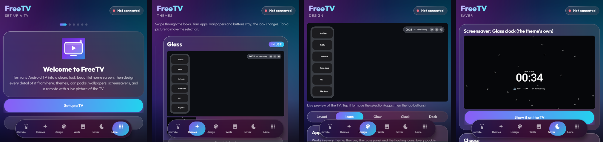

<div align="center">

# FreeTV

**Turn any Android TV into a clean, fast, beautiful home screen, then design every detail of it from your phone.**

Themes · icon packs · wallpapers · screensavers and watch faces · a remote with a live picture of the TV



[Download the latest release](../../releases/latest) · No root · No account · Nothing collected

</div>

---

## What's inside

This repository has two apps that work together:

| App | Runs on | What it does |
|---|---|---|
| **FreeTV** (`freetv/`) | Your phone | Finds the TV on your Wi-Fi, installs Glass Home on it, and lets you change everything with a live preview. Liquid-glass design. |
| **Glass Home** (`glasshome/`) | The TV | A light home screen and screensaver for Android TV / Google TV. FreeTV carries it inside, so you only install FreeTV. |

## Features

**6 themes**: Clean (apps in a row), Glass, Float, Noir, Neon and Minimal. Each one has its own clock, glow and screensaver.

**12 icon packs** that work in every theme: Banner, Original, White logo, Accent, Rainbow, Gold, Sunset, Ice, Outline, Bubble, Badge and Chrome.

**6 screensavers / watch faces**: Glass, Noir, Neon, Analog, Minimal and Photo slideshow. Each has its own clock size, font, colour, date, seconds, weather and sunrise/sunset options.

**Every detail can be changed**:
- **Layout:** icon size, spacing, focus zoom, labels and the dock side.
- **Glow:** colour and strength. The accent colour is picked from the wallpaper.
- **Clock:** 12/24 h, font, size, colour and rolling seconds.
- **Top bar:** the buttons shown there, plus RAM and temperature.

**Remote** with a live picture of the TV, a D-pad or touchpad, and quick actions.

**Wallpapers:** use your own pictures, or 8 generated aurora wallpapers to start with.

**Light on 1 GB TVs:**
- It closes streaming apps when you press Home.
- It only redraws the screen when something moves.
- An optional RAM clean-up script is included.

## Install

1. **On the TV**, turn on developer options:
   - Go to Settings → Device Preferences → About and press OK on **Build** 7 times.
   - Then go to Developer options and turn on **USB debugging** (on some TVs it's called **Network debugging**).
2. **On your phone**, download `FreeTV.apk` from [Releases](../../releases/latest) and install it. Allow installing from your browser or file manager when asked.
3. Open FreeTV and tap **Set up a TV**. It finds the TV on your Wi-Fi.
4. Choose **Allow** on the TV. FreeTV then installs Glass Home and makes it your home screen.

The phone and the TV must be on the same Wi-Fi. FreeTV talks to the TV over the network (ADB on port 5555). Nothing goes through the internet.

Tested on a Xiaomi Mi TV (Android TV 11, 1 GB RAM). It should work on most Android TV and Google TV devices.

## Undo

- In FreeTV, go to **More → TV and home** and switch back to the TV's own home screen.
- Or, from a computer, run `scripts\restore-tv.bat`.

Nothing on the TV is uninstalled. Apps that FreeTV turns off can be turned back on.

## Build from source

You need JDK 17 and the Android SDK (Android Studio installs both).

```bat
git clone https://github.com/SriRamTejaArige/FreeTV.git
cd FreeTV
scripts\build.bat
```

This builds Glass Home first, puts it inside FreeTV, and saves both apps in `dist\`. You can also open the folder in Android Studio.

**Signing:** to sign with your own release key, put `keystore.properties` and your `.jks` file in `freetv/`. Without them, the build uses the debug key. `.gitignore` keeps both files off GitHub.

```properties
storeFile=my-release.jks
storePassword=...
keyAlias=...
keyPassword=...
```

## Scripts (Windows, optional)

Put your TV's IP address and the path to `adb` in `scripts\settings.local.bat`. That file is never uploaded.

| Script | What it does |
|---|---|
| `build.bat` | Builds both apps into `dist\` |
| `install-tv.bat` | Installs Glass Home from the computer and makes it the home screen and screensaver |
| `check-tv.bat` | Saves a TV screenshot and a report: home screen, RAM, temperature, crashes |
| `ram-boost.bat` | Stops streaming apps and Play Store from running in the background (1 GB TVs) |
| `ram-undo.bat` | Undoes `ram-boost.bat` |
| `restore-tv.bat` | Brings back the TV's own home screen |

## Privacy

FreeTV collects nothing and has no accounts, ads or analytics.

The only internet request is Glass Home asking [Open-Meteo](https://open-meteo.com) for the temperature at the TV's approximate location. Everything else stays on your Wi-Fi.

## Credits

- Made by Arige Sri Ram Teja ([@SriRamTejaArige](https://github.com/SriRamTejaArige))
- Inspired by [CleanYourTV](https://github.com/Gathin23/cleanyourtv) by Gathin
- [Outfit](https://fonts.google.com/specimen/Outfit) font, under the SIL Open Font License 1.1
- Weather by [Open-Meteo](https://open-meteo.com)
- Icons drawn from Material Icons paths (Apache 2.0)

## License

MIT. See [LICENSE](LICENSE).
